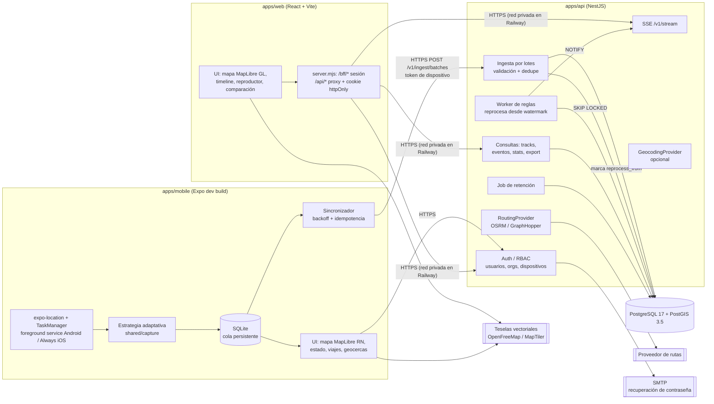

# Arquitectura técnica — Plataforma de geolocalización y trazabilidad

> Estado: **implementado** (MVP). Diseño validado por el propietario el 2026-10-27 con tres cambios: web en React + Vite (en lugar de Next.js), roles owner/admin/viewer, y servidor demo de OSRM como proveedor de rutas.
> Las filas marcadas *(revisado)* en la tabla de decisiones cambiaron durante la implementación.

## 1. Punto de partida

- El directorio del proyecto estaba vacío (solo un `robots.txt` de 0 bytes) y no era un repositorio git. No hay código existente que respetar ni que migrar.
- Entorno de desarrollo disponible: Node 25 / npm 11, Docker 29 + Compose (socket en `/var/run/docker.sock`), Java 21. **No hay** `adb`, emulador, dispositivo físico conectado, CLI de Railway ni cuenta de Railway vinculada.
- Consecuencia: el backend, la web y la base de datos se pueden construir **y verificar** localmente. La app móvil se puede construir y verificar su lógica (cola, sincronización, estrategia de captura) con pruebas, pero **la captura real en segundo plano no puede verificarse en este entorno**: queda como pendiente hasta que haya un dispositivo físico.

## 2. Principios que guían el diseño

1. **Observado ≠ inferido ≠ estimado.** `location_points` guarda solo lo que el dispositivo reportó. Detenciones, desvíos, llegadas y huecos son `tracking_events` derivados por reglas versionadas. Las rutas planificadas y los ETA son `planned_routes` con su proveedor y tipo de estimación. Las posiciones interpoladas del reproductor **no se guardan** y se dibujan con un estilo distinto.
2. **El servidor es la única fuente de verdad de los eventos.** Las reglas son funciones puras en `packages/shared/rules`. El backend las ejecuta de forma autoritativa. La app móvil reutiliza el mismo paquete (no una copia) solo para estados locales provisionales, por ejemplo "en movimiento/detenido" para adaptar la frecuencia de captura.
3. **Captura primero, sincronización después.** Toda posición se escribe en SQLite antes de cualquier intento de red. Cada registro lleva un UUID generado en el dispositivo y la ingesta es idempotente por `(device_id, client_point_id)`.
4. **Dos relojes.** `captured_at` (reloj del dispositivo, UTC) y `received_at` (reloj del servidor). Además se estima el desfase de reloj por lote.
5. **Privacidad por defecto.** Consentimiento explícito y versionado, indicador visible, revocación, retención configurable (90 días por defecto), auditoría de accesos a ubicaciones y nada de coordenadas completas en los logs generales.
6. **Infraestructura mínima.** No se usan Redis, colas externas ni almacenamiento de objetos mientras el MVP no los justifique. PostgreSQL resuelve persistencia, la cola de reprocesamiento (`SKIP LOCKED`) y la difusión en tiempo real (`LISTEN/NOTIFY`).

## 3. Diagrama de componentes



### Flujo de una posición, de punta a punta

1. El SO entrega una o varias `LocationObject` a la tarea de TaskManager, también con la app en segundo plano.
2. La estrategia de captura (función pura) decide si se conserva el punto, por distancia, tiempo, rumbo y calidad, y le asigna `seq`. Se inserta en SQLite con `sync_status = pending`.
3. El sincronizador toma hasta 500 puntos pendientes, ordenados por `captured_at`, y los envía con un `batch_id`. Si falla, reintenta con backoff exponencial con jitter y los puntos siguen en SQLite.
4. La API valida el lote con zod (contrato compartido) y lo inserta con `ON CONFLICT (device_id, client_point_id) DO NOTHING`. Responde `accepted / duplicates / rejected` por punto. El cliente borra o archiva solo los confirmados.
5. En la misma transacción se actualiza `device_sync_state` y `device_processing_state.reprocess_from = LEAST(actual, min(captured_at del lote))`. Así los puntos atrasados disparan el recálculo desde su momento.
6. El worker toma dispositivos con trabajo pendiente (`FOR UPDATE SKIP LOCKED`), carga la ventana `[reprocess_from - margen, ahora]`, ejecuta las reglas y hace upsert de eventos por `dedup_key`. Los eventos que ya no se sostienen pasan a `superseded`, no se borran. Después emite `NOTIFY`.
7. La web recibe la notificación por SSE (`/v1/stream`) y vuelve a consultar el tramo afectado.

## 4. Decisiones técnicas (ADR resumidos)

| # | Decisión | Alternativas evaluadas | Motivo |
|---|---|---|---|
| 1 | **Monorepo con npm workspaces** | pnpm, Turborepo, Nx | npm ya está instalado. Expo detecta solo los monorepos npm, mientras que pnpm necesita `node-linker=hoisted`. Railway instala con `npm ci`. Turborepo se puede agregar después si los tiempos de build lo justifican. |
| 2 | **Móvil: React Native 0.88 + Expo SDK 58 con development builds (CNG)** | RN puro, Flutter, nativo Kotlin/Swift | `expo-location` + `expo-task-manager` cubren la captura en segundo plano en ambas plataformas (foreground service en Android, `UIBackgroundModes=location` en iOS). Comparte TypeScript y contratos con el backend. **No funciona en Expo Go**: el desarrollo exige dev build. Si las pruebas en dispositivo muestran que el segundo plano no alcanza, el plan B es un módulo nativo propio o `react-native-background-geolocation` (licencia paga en Android para release). |
| 3 | **Mapa móvil: `@maplibre/maplibre-react-native`** | `react-native-maps` | Usa el mismo motor y estilo que la web (consistencia visual) y no necesita clave de Google Maps. Requiere dev build, igual que la ubicación. |
| 4 | **Backend: NestJS 12 + TypeScript, adaptador Express** | Fastify puro, Hono | El spec lo sugiere. Sus módulos, guards y Swagger encajan bien con RBAC y una API versionada. El cuello de botella esperado es la base de datos, no el framework HTTP. |
| 5 | **Contratos: zod 4 en `packages/shared` → OpenAPI** | Clases DTO de Nest, tRPC | Un solo esquema valida en API, web y móvil y genera la documentación OpenAPI (`zod-to-openapi`). Evita duplicar validaciones. |
| 6 | **Base de datos: PostgreSQL 17 + PostGIS 3.5** | Postgres sin PostGIS (lat/lon + Haversine), TimescaleDB | Hace falta PostGIS para índices GiST, geocercas poligonales, `ST_DWithin`, `ST_LineLocatePoint` (avance sobre la ruta) y `ST_SimplifyPreserveTopology` (simplificar historiales largos). TimescaleDB no está disponible como servicio administrado simple en Railway y el volumen del MVP no lo exige. |
| 7 | **Migraciones SQL versionadas a mano + `pg` con SQL parametrizado** *(revisado: sin Kysely)* | Prisma, Drizzle, TypeORM, Kysely | Prisma trata `geometry` como `Unsupported`; Drizzle-kit no modela columnas generadas con PostGIS. Las consultas son SQL con PostGIS: Kysely obligaba a mantener a mano los tipos de todas las tablas sin aportar seguridad real sobre ese SQL, así que se descartó. Runner propio: `schema_migrations` con checksum, advisory lock, una transacción por migración, solo hacia adelante. |
| 8b | **Reglas de eventos en TypeScript puro; PostGIS para almacenamiento y consultas espaciales** | Reglas en SQL/PostGIS | Las reglas (detenciones, geocercas con histéresis, corredor de desvío) necesitan estado secuencial y deben ser deterministas y testeables sin base: viven en `packages/shared/rules`. PostGIS se usa para geometrías válidas, columnas generadas, índices GiST, agregados de distancia (`ST_DistanceSphere`) y validación de polígonos. La simplificación de tracks se hace en TS porque debe conservar puntos con eventos y el id de cada registro. |
| 8 | **Procesamiento asíncrono sin Redis:** tabla `device_processing_state` + `SKIP LOCKED` | BullMQ + Redis, pg-boss | La unidad de trabajo natural es "reprocesar el dispositivo X desde T", no un mensaje por punto. Esa tabla coalesce las ráfagas y resuelve los puntos atrasados de forma determinista. En el MVP corre dentro del proceso de la API (`WORKER_ENABLED=true`). Puede separarse como servicio Railway con el mismo build y otro start. |
| 9 | **Tiempo real: SSE + `LISTEN/NOTIFY`** | WebSockets + Redis pub/sub | El flujo es unidireccional (servidor → web). SSE pasa por el proxy de Railway sin configuración especial. Reconecta con `Last-Event-ID` y, al reconectar, el cliente vuelve a consultar desde su último timestamp (el stream solo avisa; los datos salen de la API REST). `NOTIFY` permite varias réplicas. |
| 10 | **Web: React 19 + Vite (SPA) servida por un BFF mínimo (`server.mjs`, sin dependencias)** *(revisado: pedido del propietario)* | Next.js | Los dominios `*.up.railway.app` están en la Public Suffix List: web y API en subdominios distintos son *cross-site*. El BFF sirve el bundle, hace de proxy `/api/*` hacia la API por red privada (incluido SSE) y guarda el refresh token en una cookie `httpOnly; SameSite=Strict; Path=/bff`. El access token vive solo en memoria. CSRF: SameSite=Strict + cabecera obligatoria `X-Geo-Client`. La URL de la API y el estilo de mapa se leen en runtime (`/config.js`). El mismo `bff.mjs` corre como middleware de Vite en desarrollo. |
| 11 | **Mapa web: MapLibre GL JS 6 + react-map-gl 8** | Leaflet | Renderiza en WebGL, aguanta miles de puntos con estilos según los datos (calidad, procedencia, velocidad) y usa teselas vectoriales y el mismo estilo que el móvil. Leaflet en DOM/SVG se degrada con tracks largos. |
| 12 | **Autenticación propia: JWT de acceso (15 min) + refresh rotativo con detección de reuso, Argon2id** | Auth0, Clerk, Supabase Auth | Sin dependencia paga ni externa. Los dispositivos necesitan credenciales propias (token de dispositivo revocable) y eso no encaja bien en los IdP genéricos. La recuperación de contraseña necesita SMTP (Mailpit en desarrollo). |
| 13 | **Exportaciones en streaming, sin archivos** | Generar archivos y subirlos a S3 | Evita el sistema de archivos efímero del contenedor y la necesidad de un bucket. CSV, JSON, GeoJSON, GPX y KML se generan con un cursor de Postgres con tope de filas. Exportaciones asíncronas grandes quedan fuera del MVP. |
| 14 | **Despliegue: Railway IaC (`.railway/railway.ts`)** | `railway.json` (Config as Code) | Config as Code está deprecado y **deja de leerse el 2026-12-01**. IaC permite `preDeploy` (si falla, aborta el despliegue), lo que sirve para correr migraciones antes de habilitar la nueva versión. Se documenta también la configuración manual por UI como alternativa. |
| 15 | **Pruebas: Vitest (unidad), Testcontainers con `postgis/postgis` (integración), Playwright (e2e web)** | Jest, base compartida | Las pruebas de integración corren contra PostGIS real, no contra mocks. Docker está disponible localmente y en GitHub Actions. |

## 5. Estructura del repositorio

```
geoprueba/
├─ apps/
│  ├─ api/                 NestJS
│  │  ├─ src/
│  │  │  ├─ main.ts        bootstrap (PORT, 0.0.0.0, validación de env)
│  │  │  ├─ worker.ts      entrypoint opcional del worker separado
│  │  │  ├─ config/        validación de variables (zod), fail-fast
│  │  │  ├─ db/            Kysely, pool, runner de migraciones
│  │  │  ├─ auth/          login, refresh, reset, guards, tokens de dispositivo
│  │  │  ├─ orgs/          organizaciones, membresías, roles
│  │  │  ├─ devices/       vínculo, consentimiento, revocación, estado de conexión
│  │  │  ├─ ingest/        lotes, dedupe, sync state
│  │  │  ├─ tracks/        reconstrucción y simplificación
│  │  │  ├─ events/        consulta de eventos
│  │  │  ├─ processing/    worker de reglas (usa shared/rules)
│  │  │  ├─ geofences/  trips/  routing/  geocoding/
│  │  │  ├─ stats/  exports/  stream/  audit/  retention/  health/
│  │  │  └─ demo/          carga de escenarios sintéticos
│  │  └─ test/             integración (Testcontainers)
│  ├─ web/                 React + Vite
│  │  ├─ server.mjs, bff.mjs  servidor de producción: estáticos + BFF + proxy /api (SSE)
│  │  ├─ src/pages/        Panel, Mapa, Eventos, Viajes, Detalle de viaje, Geocercas, Dispositivos, Configuración, Auth
│  │  ├─ src/components/   MapBase, TrackLayers (capas), Timeline (reproductor)
│  │  └─ e2e/              Playwright
│  └─ mobile/              Expo (expo-router)
│     ├─ app/              pantallas (14 del spec)
│     ├─ src/location/     definición de la tarea de fondo, permisos, modos
│     ├─ src/queue/        SQLite: esquema, repositorio, migraciones locales
│     ├─ src/sync/         sincronizador, backoff, recepción de config remota
│     └─ src/api/          cliente tipado (contratos de shared)
├─ packages/
│  └─ shared/
│     ├─ contracts/        esquemas zod de la API v1 (fuente única)
│     ├─ geo/              haversine, rumbo, proyección sobre polilínea, bbox
│     ├─ rules/            reglas puras: calidad, saltos, huecos, detenciones,
│     │                    geocercas con histéresis, desvío, avance de viaje
│     └─ capture/          estrategia adaptativa de captura (pura, testeable)
├─ database/
│  ├─ migrations/          0001_init.sql, 0002_… (solo hacia adelante)
│  └─ seeds/demo/          escenarios sintéticos (GeoJSON con timestamps)
├─ docs/
├─ .railway/railway.ts     infraestructura de Railway (IaC)
├─ scripts/simulate-device.mjs  prueba de punta a punta con el mismo motor de sync de la app
├─ docker-compose.yml      postgis, mailpit
├─ .env.example
└─ .github/workflows/ci.yml
```

## 6. Producto A — App móvil (estructura funcional)

| Módulo | Responsabilidad | Notas |
|---|---|---|
| Autenticación | Registro, login, recuperación (abre un enlace web), logout | Tokens en `expo-secure-store`. |
| Vínculo de dispositivo | Genera `install_id` (UUID guardado en SecureStore), registra el dispositivo y recibe el token de dispositivo | Al reinstalar se genera un dispositivo nuevo. El anterior se puede revocar desde la web. |
| Consentimiento | Pantalla de privacidad con versión de texto, aceptación explícita y opción de compartir con la organización | Sin consentimiento vigente la ingesta responde `403 CONSENT_REQUIRED`. |
| Permisos | Primero en uso, después "siempre" con explicación previa (Android 11+ abre Ajustes) | La app funciona en modo degradado con solo permiso en uso. |
| Captura | Tarea `TaskManager` + estrategia de `shared/capture` | Modos: ahorro, normal, viaje, intensivo. Los parámetros vienen del servidor y hay valores locales seguros. |
| Cola | SQLite: `points`, `sessions`, `outbox_meta` | Estados: `pending → sending → acked | rejected`. Los `acked` se purgan después de N días. |
| Sincronización | Lotes de hasta 500 puntos, backoff 2^n con jitter (tope 15 min), dispara al reconectar o al pasar a primer plano | Reporta `pendingCount` en cada lote/heartbeat. |
| UI | 14 pantallas del spec, con el mapa como eje | Indicador permanente de estado: grabando, sin permisos, esperando conexión o pausado. |

## 7. Producto B — Plataforma web (estructura funcional)

Layout de escritorio: navegación lateral, panel de filtros (dispositivo, rango, tipos de evento), **mapa central**, panel de detalle a la derecha y timeline con reproductor abajo. En tablet o móvil los paneles pasan a ser hojas deslizables.

| Vista | Fuente de datos |
|---|---|
| Dashboard | `GET /v1/stats/overview`. Estado vacío con instrucciones si no hay dispositivos. |
| Mapa / recorrido | `GET /v1/devices/:id/track?from&to&tolerance`, que devuelve segmentos y discontinuidades ya calculados por el servidor. |
| Timeline / reproductor | Mismos puntos más `GET /v1/events`. La interpolación es solo visual y lleva una etiqueta. |
| Comparación | `GET /v1/trips/:id/comparison` (cálculo en el servidor). |
| Dispositivos | `GET /v1/devices` con estado de conexión derivado en el servidor. |
| Exportación | `GET /v1/exports/track?format=…` en streaming. |
