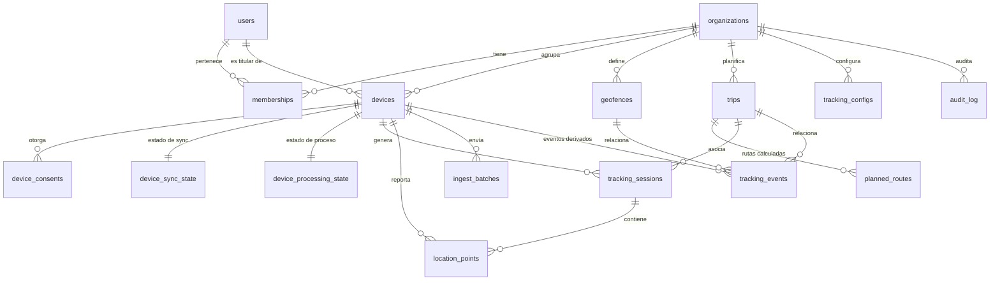

# Modelo de datos inicial

> Estado: **borrador de Fase 1**. Va a convertirse en `database/migrations/0001_init.sql` cuando se valide el diseño.
> Todas las marcas temporales son `timestamptz` y se guardan en UTC. La conversión a zona horaria se hace en la interfaz.

## 1. Entidades y relaciones



### Modelo de acceso (autorización)

- Un **usuario** pertenece a una o más **organizaciones** con rol `owner | admin | viewer`. Al registrarse se crea su organización personal con rol `owner`.
- Un **dispositivo** pertenece a una organización y tiene un **titular** (`holder_user_id`), que es quien lo lleva y otorga el consentimiento.
- Quién ve las posiciones de un dispositivo:
  - el titular, siempre;
  - `owner`, `admin` y `viewer` de la organización, solo si el consentimiento vigente del dispositivo tiene `share_with_org = true`.
- Solo `owner` y `admin` pueden revocar dispositivos, gestionar geocercas o viajes de la organización y cambiar la retención. El titular puede revocar su propio dispositivo y su consentimiento en cualquier momento.
- Todas las consultas filtran por un `device_id IN (dispositivos visibles)` calculado en el servidor. Pedir un id ajeno devuelve `404`, no `403`, para no confirmar que existe.

## 2. Esquema SQL (borrador)

```sql
CREATE EXTENSION IF NOT EXISTS postgis;
CREATE EXTENSION IF NOT EXISTS citext;
CREATE EXTENSION IF NOT EXISTS pgcrypto;          -- gen_random_uuid()

-- ───────────── Identidad y tenencia ─────────────
CREATE TABLE organizations (
  id               uuid PRIMARY KEY DEFAULT gen_random_uuid(),
  name             text NOT NULL CHECK (length(name) BETWEEN 1 AND 120),
  retention_days   int  NOT NULL DEFAULT 90 CHECK (retention_days BETWEEN 1 AND 3650),
  created_at       timestamptz NOT NULL DEFAULT now()
);

CREATE TABLE users (
  id                uuid PRIMARY KEY DEFAULT gen_random_uuid(),
  email             citext NOT NULL UNIQUE,
  password_hash     text   NOT NULL,                       -- argon2id
  display_name      text   NOT NULL,
  email_verified_at timestamptz,
  created_at        timestamptz NOT NULL DEFAULT now(),
  disabled_at       timestamptz
);

CREATE TYPE org_role AS ENUM ('owner','admin','viewer');
CREATE TABLE memberships (
  org_id     uuid NOT NULL REFERENCES organizations(id) ON DELETE CASCADE,
  user_id    uuid NOT NULL REFERENCES users(id)         ON DELETE CASCADE,
  role       org_role NOT NULL,
  created_at timestamptz NOT NULL DEFAULT now(),
  PRIMARY KEY (org_id, user_id)
);

CREATE TABLE refresh_tokens (                              -- usuarios y dispositivos
  id          uuid PRIMARY KEY DEFAULT gen_random_uuid(),
  user_id     uuid NOT NULL REFERENCES users(id) ON DELETE CASCADE,
  device_id   uuid,                                       -- FK abajo; NULL = sesión web
  family_id   uuid NOT NULL,                              -- rotación con detección de reuso
  token_hash  bytea NOT NULL UNIQUE,                      -- sha256, nunca el token en claro
  expires_at  timestamptz NOT NULL,
  revoked_at  timestamptz,
  created_at  timestamptz NOT NULL DEFAULT now()
);

CREATE TABLE password_reset_tokens (
  id         uuid PRIMARY KEY DEFAULT gen_random_uuid(),
  user_id    uuid NOT NULL REFERENCES users(id) ON DELETE CASCADE,
  token_hash bytea NOT NULL UNIQUE,
  expires_at timestamptz NOT NULL,                        -- 30 min
  used_at    timestamptz
);

-- ───────────── Dispositivos ─────────────
CREATE TYPE device_platform AS ENUM ('android','ios','demo');
CREATE TYPE device_status   AS ENUM ('active','revoked');

CREATE TABLE devices (
  id              uuid PRIMARY KEY DEFAULT gen_random_uuid(),
  org_id          uuid NOT NULL REFERENCES organizations(id) ON DELETE CASCADE,
  holder_user_id  uuid NOT NULL REFERENCES users(id) ON DELETE CASCADE,
  install_id      uuid NOT NULL,                          -- generado en la app
  name            text NOT NULL,
  platform        device_platform NOT NULL,
  app_version     text, os_version text, model text,
  status          device_status NOT NULL DEFAULT 'active',
  is_demo         boolean NOT NULL DEFAULT false,
  tracking_config_id uuid,                                -- FK abajo
  created_at      timestamptz NOT NULL DEFAULT now(),
  revoked_at      timestamptz,
  UNIQUE (org_id, install_id),
  CHECK (is_demo = (platform = 'demo'))
);
ALTER TABLE refresh_tokens ADD FOREIGN KEY (device_id) REFERENCES devices(id) ON DELETE CASCADE;

CREATE TABLE device_consents (                             -- historial, no se sobrescribe
  id              uuid PRIMARY KEY DEFAULT gen_random_uuid(),
  device_id       uuid NOT NULL REFERENCES devices(id) ON DELETE CASCADE,
  user_id         uuid NOT NULL REFERENCES users(id)   ON DELETE CASCADE,
  consent_version text NOT NULL,                          -- versión del texto aceptado
  share_with_org  boolean NOT NULL,
  granted_at      timestamptz NOT NULL DEFAULT now(),
  revoked_at      timestamptz
);
CREATE UNIQUE INDEX device_consents_one_active ON device_consents(device_id) WHERE revoked_at IS NULL;

CREATE TYPE tracking_mode AS ENUM ('battery_saver','normal','trip','intensive');
CREATE TABLE tracking_configs (                            -- estrategia servida al móvil
  id         uuid PRIMARY KEY DEFAULT gen_random_uuid(),
  org_id     uuid NOT NULL REFERENCES organizations(id) ON DELETE CASCADE,
  name       text NOT NULL,
  version    int  NOT NULL DEFAULT 1,
  params     jsonb NOT NULL,                              -- validado por shared/contracts
  updated_at timestamptz NOT NULL DEFAULT now()
);
ALTER TABLE devices ADD FOREIGN KEY (tracking_config_id) REFERENCES tracking_configs(id) ON DELETE SET NULL;

-- ───────────── Viajes y rutas ─────────────
CREATE TYPE trip_status AS ENUM ('planned','in_progress','completed','cancelled','interrupted');
CREATE TABLE trips (
  id                  uuid PRIMARY KEY DEFAULT gen_random_uuid(),
  org_id              uuid NOT NULL REFERENCES organizations(id) ON DELETE CASCADE,
  device_id           uuid REFERENCES devices(id) ON DELETE SET NULL,
  name                text NOT NULL,
  origin              geometry(Point,4326) NOT NULL,
  origin_label        text,
  destination         geometry(Point,4326) NOT NULL,
  destination_label   text,
  arrival_radius_m    int NOT NULL DEFAULT 100 CHECK (arrival_radius_m BETWEEN 10 AND 5000),
  planned_start_at    timestamptz,
  planned_arrival_at  timestamptz,
  status              trip_status NOT NULL DEFAULT 'planned',
  actual_start_at     timestamptz,
  actual_end_at       timestamptz,
  notes               text,
  created_by          uuid REFERENCES users(id) ON DELETE SET NULL,
  created_at          timestamptz NOT NULL DEFAULT now()
);

CREATE TYPE duration_kind AS ENUM ('provider_no_traffic','provider_with_traffic','basic_estimate');
CREATE TABLE planned_routes (
  id             uuid PRIMARY KEY DEFAULT gen_random_uuid(),
  trip_id        uuid NOT NULL REFERENCES trips(id) ON DELETE CASCADE,
  provider       text NOT NULL,                           -- 'osrm' | 'graphhopper' | 'straight_line'
  profile        text NOT NULL,                           -- 'driving' | 'cycling' | 'foot'
  geom           geometry(LineString,4326) NOT NULL,
  distance_m     double precision NOT NULL CHECK (distance_m >= 0),
  duration_s     double precision CHECK (duration_s >= 0),
  duration_kind  duration_kind NOT NULL,
  provider_meta  jsonb NOT NULL DEFAULT '{}',             -- versión de datos, atribución
  is_current     boolean NOT NULL DEFAULT true,
  computed_at    timestamptz NOT NULL DEFAULT now()
);
CREATE UNIQUE INDEX planned_routes_one_current ON planned_routes(trip_id) WHERE is_current;

-- ───────────── Sesiones y posiciones (datos observados) ─────────────
CREATE TABLE tracking_sessions (
  id             uuid PRIMARY KEY,                        -- generado en el dispositivo (offline)
  device_id      uuid NOT NULL REFERENCES devices(id) ON DELETE CASCADE,
  trip_id        uuid REFERENCES trips(id) ON DELETE SET NULL,
  mode           tracking_mode NOT NULL,
  config_snapshot jsonb NOT NULL,                         -- parámetros efectivamente aplicados
  started_at     timestamptz NOT NULL,                    -- reloj del dispositivo
  ended_at       timestamptz,
  end_reason     text,                                    -- 'user' | 'permission_revoked' | 'trip_completed' ...
  is_demo        boolean NOT NULL DEFAULT false,
  created_at     timestamptz NOT NULL DEFAULT now(),
  CHECK (ended_at IS NULL OR ended_at >= started_at)
);
CREATE INDEX ON tracking_sessions (device_id, started_at DESC);

CREATE TABLE ingest_batches (
  id              uuid PRIMARY KEY DEFAULT gen_random_uuid(),
  device_id       uuid NOT NULL REFERENCES devices(id) ON DELETE CASCADE,
  client_batch_id uuid NOT NULL,
  sent_at         timestamptz NOT NULL,                   -- reloj del dispositivo
  received_at     timestamptz NOT NULL DEFAULT now(),     -- reloj del servidor
  clock_skew_ms   int,                                    -- received_at - sent_at (aprox.)
  accepted int NOT NULL, duplicates int NOT NULL, rejected int NOT NULL,
  UNIQUE (device_id, client_batch_id)
);

CREATE TYPE location_source AS ENUM ('gps','fused','network','unknown','demo');
CREATE TABLE location_points (
  id                   bigint GENERATED ALWAYS AS IDENTITY PRIMARY KEY,
  device_id            uuid NOT NULL REFERENCES devices(id) ON DELETE CASCADE,
  session_id           uuid NOT NULL REFERENCES tracking_sessions(id) ON DELETE CASCADE,
  client_point_id      uuid NOT NULL,                     -- idempotencia
  seq                  int  NOT NULL CHECK (seq >= 0),    -- monotónico por sesión
  lat                  double precision NOT NULL CHECK (lat BETWEEN -90 AND 90),
  lon                  double precision NOT NULL CHECK (lon BETWEEN -180 AND 180),
  geom                 geometry(Point,4326) GENERATED ALWAYS AS (ST_SetSRID(ST_MakePoint(lon, lat), 4326)) STORED,
  captured_at          timestamptz NOT NULL,              -- reloj del dispositivo (UTC)
  received_at          timestamptz NOT NULL DEFAULT now(),-- reloj del servidor
  accuracy_m           real CHECK (accuracy_m >= 0),
  altitude_m           real,
  altitude_accuracy_m  real CHECK (altitude_accuracy_m >= 0),
  speed_mps            real CHECK (speed_mps >= 0),
  heading_deg          real CHECK (heading_deg >= 0 AND heading_deg < 360),
  source               location_source NOT NULL DEFAULT 'unknown',
  is_mocked            boolean,
  battery_level        real CHECK (battery_level BETWEEN 0 AND 1),
  quality_flags        text[] NOT NULL DEFAULT '{}',      -- 'low_accuracy','jump','future_ts','mocked','out_of_order'
  batch_id             uuid REFERENCES ingest_batches(id) ON DELETE SET NULL,
  is_demo              boolean NOT NULL DEFAULT false,
  UNIQUE (device_id, client_point_id)
);
CREATE INDEX location_points_device_time ON location_points (device_id, captured_at);
CREATE INDEX location_points_session_seq ON location_points (session_id, seq);
CREATE INDEX location_points_geom        ON location_points USING gist (geom);
CREATE INDEX location_points_received    ON location_points USING brin (received_at);

-- ───────────── Estado de sincronización y procesamiento ─────────────
CREATE TABLE device_sync_state (
  device_id              uuid PRIMARY KEY REFERENCES devices(id) ON DELETE CASCADE,
  last_contact_at        timestamptz,                     -- cualquier request autenticado
  last_point_received_at timestamptz,
  last_point_captured_at timestamptz,
  last_point_id          bigint,
  client_pending_count   int,                             -- informado por el cliente
  client_reported_at     timestamptz,
  last_batch_id          uuid,
  last_error             text,
  app_version            text
);

CREATE TABLE device_processing_state (
  device_id        uuid PRIMARY KEY REFERENCES devices(id) ON DELETE CASCADE,
  reprocess_from   timestamptz,                           -- NULL = al día
  processed_until  timestamptz,
  rules_version    int NOT NULL DEFAULT 0,
  rule_state       jsonb NOT NULL DEFAULT '{}',           -- estado de máquinas (geocercas, detención)
  locked_until     timestamptz,
  attempts         int NOT NULL DEFAULT 0,
  last_error       text
);
CREATE INDEX ON device_processing_state (reprocess_from) WHERE reprocess_from IS NOT NULL;

-- ───────────── Geocercas ─────────────
CREATE TYPE geofence_kind  AS ENUM ('home','work','depot','office','delivery','poi','trip_origin','trip_destination','other');
CREATE TYPE geofence_shape AS ENUM ('circle','polygon');
CREATE TABLE geofences (
  id                 uuid PRIMARY KEY DEFAULT gen_random_uuid(),
  org_id             uuid NOT NULL REFERENCES organizations(id) ON DELETE CASCADE,
  name               text NOT NULL,
  kind               geofence_kind NOT NULL,
  shape              geofence_shape NOT NULL,
  center             geometry(Point,4326),                -- círculo
  radius_m           double precision CHECK (radius_m BETWEEN 10 AND 50000),
  polygon            geometry(Polygon,4326),              -- polígono
  area               geography GENERATED ALWAYS AS (
                       CASE shape WHEN 'circle' THEN ST_Buffer(center::geography, radius_m)
                                  ELSE polygon::geography END) STORED,
  enter_dwell_s      int NOT NULL DEFAULT 60,             -- permanencia mínima para confirmar entrada
  exit_dwell_s       int NOT NULL DEFAULT 60,
  hysteresis_m       int NOT NULL DEFAULT 25,             -- banda en el borde
  active             boolean NOT NULL DEFAULT true,
  created_by         uuid REFERENCES users(id) ON DELETE SET NULL,
  created_at         timestamptz NOT NULL DEFAULT now(),
  CHECK ((shape = 'circle'  AND center IS NOT NULL AND radius_m IS NOT NULL AND polygon IS NULL)
      OR (shape = 'polygon' AND polygon IS NOT NULL AND ST_IsValid(polygon) AND center IS NULL))
);
CREATE INDEX ON geofences USING gist (area);

-- ───────────── Eventos (datos inferidos) ─────────────
CREATE TYPE event_type AS ENUM (
  'movement_started','stop','movement_resumed','heading_change',
  'geofence_enter','geofence_exit','arrival','route_deviation',
  'signal_gap','capture_resumed','gps_outlier','trip_started','trip_completed');
CREATE TYPE event_confidence AS ENUM ('confirmed','probable','possible','insufficient_data');
CREATE TYPE event_status     AS ENUM ('active','superseded');
CREATE TYPE event_source     AS ENUM ('server_rules','device','user');

CREATE TABLE tracking_events (
  id            uuid PRIMARY KEY DEFAULT gen_random_uuid(),
  device_id     uuid NOT NULL REFERENCES devices(id) ON DELETE CASCADE,
  session_id    uuid REFERENCES tracking_sessions(id) ON DELETE CASCADE,
  trip_id       uuid REFERENCES trips(id) ON DELETE SET NULL,
  geofence_id   uuid REFERENCES geofences(id) ON DELETE SET NULL,
  type          event_type NOT NULL,
  occurred_at   timestamptz NOT NULL,                     -- inicio
  ended_at      timestamptz,                              -- eventos con duración: stop, signal_gap, deviation
  lat double precision, lon double precision,
  point_id      bigint REFERENCES location_points(id) ON DELETE SET NULL,
  confidence    event_confidence NOT NULL,
  rule_id       text NOT NULL,                            -- p. ej. 'stop.v1'
  rule_version  int  NOT NULL,
  rule_params   jsonb NOT NULL,                           -- umbrales usados
  evidence      jsonb NOT NULL,                           -- ids de puntos, métricas -> auditable
  source        event_source NOT NULL DEFAULT 'server_rules',
  dedup_key     text NOT NULL,                            -- rule_id + device + ancla temporal
  status        event_status NOT NULL DEFAULT 'active',
  is_demo       boolean NOT NULL DEFAULT false,
  created_at    timestamptz NOT NULL DEFAULT now(),
  superseded_at timestamptz
);
CREATE UNIQUE INDEX tracking_events_dedup ON tracking_events (device_id, dedup_key) WHERE status = 'active';
CREATE INDEX ON tracking_events (device_id, occurred_at);
CREATE INDEX ON tracking_events (trip_id, occurred_at) WHERE trip_id IS NOT NULL;

-- ───────────── Auditoría (append-only) ─────────────
CREATE TABLE audit_log (
  id              bigint GENERATED ALWAYS AS IDENTITY PRIMARY KEY,
  org_id          uuid REFERENCES organizations(id) ON DELETE SET NULL,
  actor_user_id   uuid REFERENCES users(id) ON DELETE SET NULL,
  actor_device_id uuid REFERENCES devices(id) ON DELETE SET NULL,
  action          text NOT NULL,                          -- 'track.view','export.gpx','device.revoke'...
  target_type     text, target_id text,
  ip              inet, user_agent text,
  metadata        jsonb NOT NULL DEFAULT '{}',            -- sin coordenadas
  created_at      timestamptz NOT NULL DEFAULT now()
);
CREATE INDEX ON audit_log (org_id, created_at DESC);
```

## 3. Reglas de borrado y retención

| Acción | Efecto |
|---|---|
| Revocar dispositivo | `status = revoked`, se revocan sus refresh tokens y la ingesta responde 401. El historial **se conserva** hasta que venza la retención. |
| Revocar consentimiento | Se dejan de aceptar puntos (`403 CONSENT_REQUIRED`). Si `share_with_org` pasa a `false`, los miembros de la organización dejan de ver el historial y el titular lo sigue viendo. |
| Eliminar dispositivo (titular u owner/admin) | Borrado físico en cascada de sesiones, puntos, eventos y estados. Queda un registro de auditoría sin coordenadas. |
| Eliminar cuenta | Borrado físico en cascada de los dispositivos del titular. Las organizaciones donde era único owner se eliminan. |
| Retención diaria | Borra `location_points` con `captured_at < now() - retention_days` por organización, en lotes de 10k. Después borra eventos y sesiones que quedaron sin puntos. La auditoría se retiene 365 días. |
| Datos demo | `is_demo = true` en dispositivo, sesión, puntos y eventos. Se borran con `DELETE … WHERE is_demo`. La UI los muestra siempre con la etiqueta DEMO. |

## 4. Escalabilidad del almacenamiento

- **MVP sin particionado.** Por ejemplo, 100 dispositivos × 1 punto cada 15 s × 10 h/día ≈ 240 k filas/día, unos 22 M a 90 días. Postgres lo maneja con el índice `(device_id, captured_at)`.
- **Camino a particionado:** convertir `location_points` en tabla particionada por rango mensual de `captured_at`. Requiere que la clave única incluya `captured_at`: `UNIQUE (device_id, client_point_id, captured_at)`. Es seguro porque el cliente reenvía siempre el mismo `captured_at` para el mismo id. La retención pasaría a `DROP PARTITION`. Umbral sugerido: alrededor de 100 M filas o cuando el borrado diario degrade la base.

## 5. Calidad y procedencia de los puntos

| Concepto | Dónde vive | Cómo se muestra |
|---|---|---|
| Punto observado | `location_points` | Círculo con color según `accuracy_m` (≤20 m, ≤50 m, >50 m). |
| Punto marcado `jump` o `mocked` | `location_points.quality_flags` | Se excluye de la línea y aparece como un marcador de advertencia. |
| Hueco (sin datos) | Evento `signal_gap` + corte de segmento en `/track` | Sin línea entre los extremos y un marcador con la duración del hueco. |
| Posición interpolada (reproductor) | No se persiste | Marcador hueco o atenuado con la leyenda "interpolada". |
| Ruta estimada | `planned_routes` | Línea discontinua con proveedor y `duration_kind`. |
